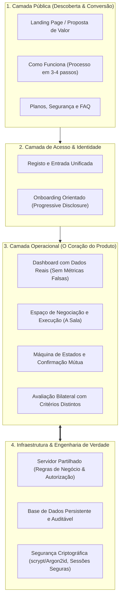
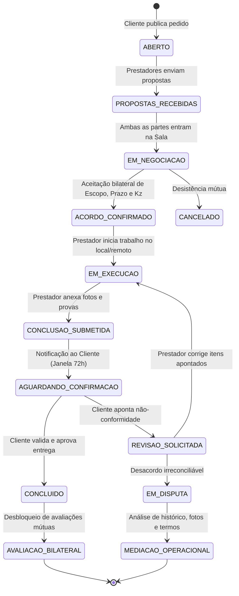

# SAAS & WEB PRODUCT DESIGN STANDARD (SWPDS)
## Manual Universal de Arquitetura de Informação, Experiência do Utilizador (UX) e Engenharia de Produto

> **Princípio Fundamental:**  
> *«O utilizador não deve ter de pensar em como utilizar o produto. Deve conseguir concentrar-se naquilo que veio fazer.»*  
> — Steve Krug (*Don't Make Me Think*), adaptado para Engenharia e Desenho de Produto.

---

## 1. A Anatomia Estrutural de um Produto Digital (SaaS & Marketplaces)

Um produto digital bem-sucedido não é uma coleção aleatória de ecrãs. Ele divide-se em **4 camadas operacionais interligadas**, cada uma com responsabilidades estritas e intransponíveis:



---

## 2. A Camada Pública: O Teste dos 5 Segundos

A área pública tem como única função transformar um visitante curioso num utilizador consciente e seguro.

### As Três Perguntas Obrigatórias
Nos primeiros **5 segundos** de navegação, qualquer pessoa (leiga ou especialista) tem de conseguir responder:
1. **O que é isto?** — Definição direta e sem metáforas publicitárias vazias.
2. **Que problema resolve para mim?** — Apresentação simétrica das vantagens:
   - Para quem **precisa de resolver uma necessidade**.
   - Para quem **possui competências e procura trabalho**.
3. **O que devo fazer agora?** — Uma chamada à ação (*Primary CTA*) evidente e sem fricção.

### Regras de Ouro da Interface Pública:
- **Proibição de Dados Fictícios**: Nunca apresentar contadores inflacionados (*"300+ empresas"*, *"4.000 clientes satisfeitos"* ou *"98% de pontualidade"*) quando o produto ainda não possui essa massa comprovada. Os utilizadores e investidores detetam falsidade imediatamente.
- **Transparência de Estados**: Se a plataforma está em arranque regional, valoriza-se o rigor, a verificação e a segurança do processo, não o volume inventado.
- **Limpeza no Cabeçalho (Navbar)**: A barra superior serve para navegar, não para acumular seletores. Seletores permanentes de língua, tema escuro e geolocalização detalhada pertencem ao menu do utilizador ou ao rodapé/definições.

---

## 3. Autenticação e Entrada: Uma Conta, Várias Possibilidades

### O Erro Comum
Obrigar o visitante a escolher se é "Cliente" ou "Prestador" antes sequer de ter uma conta. Na vida real, a mesma pessoa pode hoje contratar um canalizador para a sua casa e amanhã prestar serviços de consultoria informática ou reparações elétricas.

### O Padrão Correto
1. **Registo Unificado**: A conta pertence ao cidadão ou à empresa (Nome Real, Contacto de E-mail ou Telemóvel, Palavra-Passe Forte).
2. **Boas-Vindas Contextualizadas pós-registo**:
   > *"Olá, [Nome Real]. O que pretende fazer hoje no SALU?"*  
   > `[Opção A: Preciso de um serviço]` &nbsp;&nbsp; `[Opção B: Quero prestar serviços]`  
   > *Nota esclarecedora: «Não se preocupe, a sua conta permite fazer ambos e pode alternar a qualquer momento.»*

---

## 4. Progressive Disclosure: Formulários e Configurações

O cérebro humano bloqueia quando confrontado com formulários de 20 campos. A técnica de **Progressive Disclosure (Revelação Progressiva)** é a base do design profissional:

```
Passo 1: Qual é a necessidade principal? (Escolha de Categoria + Opção «Outros»)
   ↓
Passo 2: Onde deve ser executado? (Província e Município Oficial)
   ↓
Passo 3: Detalhes, fotos e necessidade de vistoria prévia
   ↓
Passo 4: Revisão clara e publicação
```

### Regras de Formulários:
1. **Explicar antes de exigir**: Ao lado de campos como *"Raio de Atendimento"* ou *"NIF"*, explicar por que motivo a informação é pedida e quem terá acesso a ela (Pública vs. Privada).
2. **Opção de Desativação / Campo Aberto**: O prestador deve poder desativar limites de raio para atender a nível provincial ou nacional.
3. **A Opção Universal «Outros»**: Nenhuma lista de categorias cobre a totalidade do trabalho humano. A opção *"Outros"* deve permitir escrita livre. O sistema absorve termos recorrentes para enriquecer a taxonomia oficial.

---

## 5. O Coração Operacional: A Sala de Negociação e Execução

Um SaaS de intermediação não é uma lista telefónica nem um mero chat. É um **ambiente seguro de gestão contratual bilateral**.



### Matriz de Casos Críticos e Resolução de Conflitos:

| Cenário Crítico | Condição & Gatilho | Ação do Sistema | Consequência Operacional |
| :--- | :--- | :--- | :--- |
| **Cliente Ausente** | 72 horas úteis após submissão de fotos de conclusão sem resposta | Emissão de 2 avisos (WhatsApp/SMS). Bloqueio de novas ações. | Transição para *Inspeção Assistida* pela moderação, sem libertação cega de valores. |
| **Trabalho Rejeitado** | Cliente rejeita a entrega apresentada | Exigência de anexar fotografia e descrever a cláusula do acordo não cumprida. | Estado transita para `REVISAO_SOLICITADA`. Prestador tem 48h para agendar retificação sem custos. |
| **Trabalho Parcial** | Impossibilidade técnica ou quebra de escopo | Qualquer uma das partes pode propor um *Aditamento de Escopo e Valor*. | O valor final é renegociado apenas para o diagnóstico/etapa executada, com aceitação bilateral obrigatória. |
| **Cancelamento Pós-Acordo** | Imprevisto antes de iniciar a execução | Cancelamento bilateral sem custos registado no histórico com justificação. | Se o prestador já tiver deslocado e sinalizado *Em Execução*, é devida taxa de deslocação acordada. |
| **Privacidade Estrita** | Consulta de histórico de mensagens e anexos | Verificação rigorosa no servidor (`requester_id === customer_id \|\| requester_id === provider_id`). | Bloqueio total a terceiros. Acesso concedido exclusivamente ao moderador quando houver `EM_DISPUTA`. |

---

## 6. Sistema de Avaliação e Reputação Autêntica

### Princípio da Não-Autoavaliação
Um utilizador **nunca pode avaliar o seu próprio trabalho**. As avaliações só existem após uma relação de trabalho confirmada no sistema.

### Critérios Diferenciados por Papel:
- **Como o Cliente Avalia o Prestador**:
  1. *Qualidade da Execução* (O trabalho ficou bem feito e funcional?)
  2. *Cumprimento de Prazos* (Chegou na hora acordada e entregou no prazo?)
  3. *Comunicação & Seriedade* (Foi transparente sobre custos, materiais e processo?)
- **Como o Prestador Avalia o Cliente**:
  1. *Clareza do Pedido* (O problema descrito correspondia à realidade?)
  2. *Seriedade & Acesso* (Disponibilizou o local e materiais acordados?)
  3. *Cumprimento dos Acordos* (Respeitou o valor e as condições estabelecidas?)

---

## 7. Linguagem Humana vs. Jargão Técnico

Toda a interface deve falar a linguagem da pessoa real. Os termos devem ser adaptados à cultura e hábitos do país:

| Nunca Utilizar (Jargão Artificial) | Substituir Por (Linguagem Humana e Direta) |
| :--- | :--- |
| *Vendor Audit / Fast Match* | **Avaliação do Prestador / Ligação Direta** |
| *Jump Start Onboarding* | **Começo Rápido / Configuração Inicial** |
| *Rating & On-time: 98%* | **Seriedade & Cumprimento de Prazos** |
| *Submeter Payload / Entidade* | **Publicar Pedido / Registar Proposta** |
| *Execute Escrow Release* | **Confirmar Conclusão do Serviço** |
| *State: Disputed Exception* | **Em Análise de Mediação** |
| *Bairro Talatona, Luanda* | **Município de Talatona (Respeitar a DPA oficial)** |

---

## 8. Segurança e Persistência de Dados na Engenharia

Um produto não é um SaaS porque tem um ecrã de login. É um SaaS se mantiver integridade técnica entre dispositivos diferentes:

1. **Proteção Criptográfica de Palavras-Passe**:
   - Proibição de SHA-256 simples ou MD5.
   - Utilização obrigatória de funções com custo de memória e processamento: **scrypt** (com salt aleatório de 16 bytes por utilizador e comparação em tempo constante `timingSafeEqual`) ou **Argon2id**.
   - O campo de hash nunca pode ser retornado em APIs ou exposto em logs.
2. **Integridade de Sessão**:
   - Cada pedido ao servidor deve validar a identidade do remetente. Nenhum utilizador pode criar propostas, aceitar acordos ou enviar mensagens fazendo-se passar por outro.
3. **Fontes de Verdade e Persistência**:
   - Para que o cliente no telemóvel e o prestador no computador vejam a mesma informação, o backend tem de partilhar a mesma base de dados com armazenamento em disco persistente montado.
   - `localStorage` ou `IndexedDB` são apenas para preferências de interface locais temporárias; nunca para substituir uma base de dados partilhada.

---

## 9. UX Readiness Checklist (A Lista de Verificação dos 12 Critérios)

Antes de qualquer versão do SALU (ou de qualquer outro produto) ser aprovada para utilização com clientes reais, tem de passar nos 12 critérios:

- [ ] **1. Teste dos 5 Segundos**: A página inicial esclarece de imediato o que é o SALU e o que fazer.
- [ ] **2. Zero Dados Falsos**: Não há contadores de milhares de utilizadores ou avaliações forçadas.
- [ ] **3. Uma Só Conta**: Não obriga a escolher "Cliente" ou "Prestador" no ecrã de registo.
- [ ] **4. Autenticação Segura**: Palavras-passe encriptadas com scrypt/salt; sem exposição de credenciais.
- [ ] **5. Ação Principal Evidente**: Cada ecrã tem um botão de ação primário destacado dos secundários.
- [ ] **6. Progressive Disclosure**: Formulários complexos são divididos em etapas lógicas com botão de voltar.
- [ ] **7. Opção «Outros» Ativa**: Categorias e especialidades permitem escrita livre sem bloqueios.
- [ ] **8. DPA Oficial Respeitada**: Estrutura geográfica angolana segue a Lei n.º 14/24 (com Camama autónomo).
- [ ] **9. Sala SALU Bilateral**: Acordos e conclusões exigem confirmação mútua documentada.
- [ ] **10. Avaliação Sem Autoavaliação**: Ninguém pode avaliar o seu próprio serviço.
- [ ] **11. Estados Vazios Construtivos**: Contas novas mostram exatamente o que fazer a seguir, em vez de métricas inventadas.
- [ ] **12. Teste Multi-Dispositivo**: O pedido publicado num equipamento aparece em direto no equipamento do prestador.
